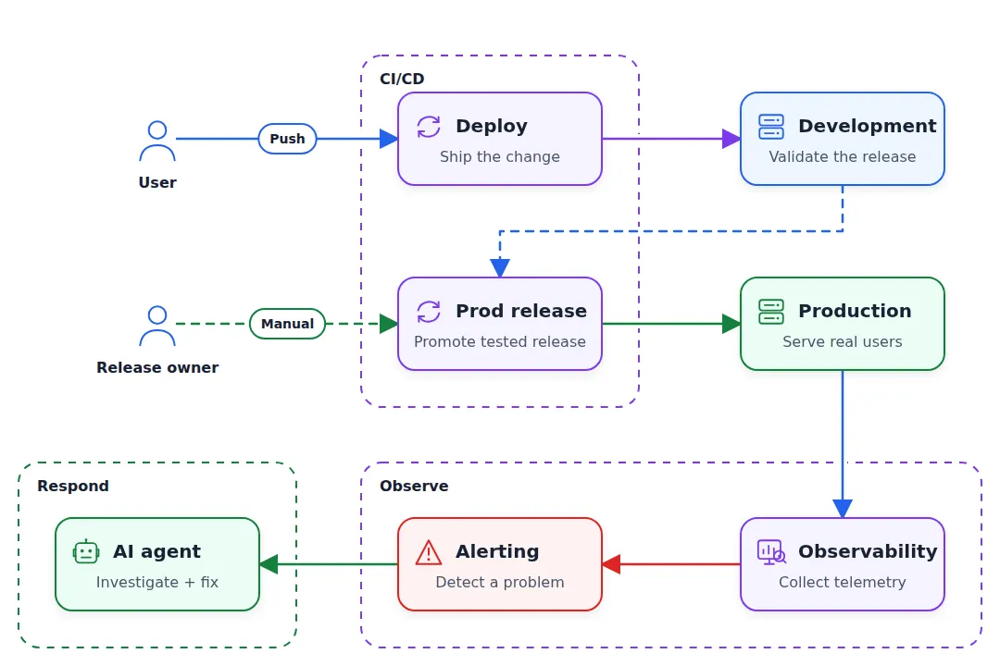
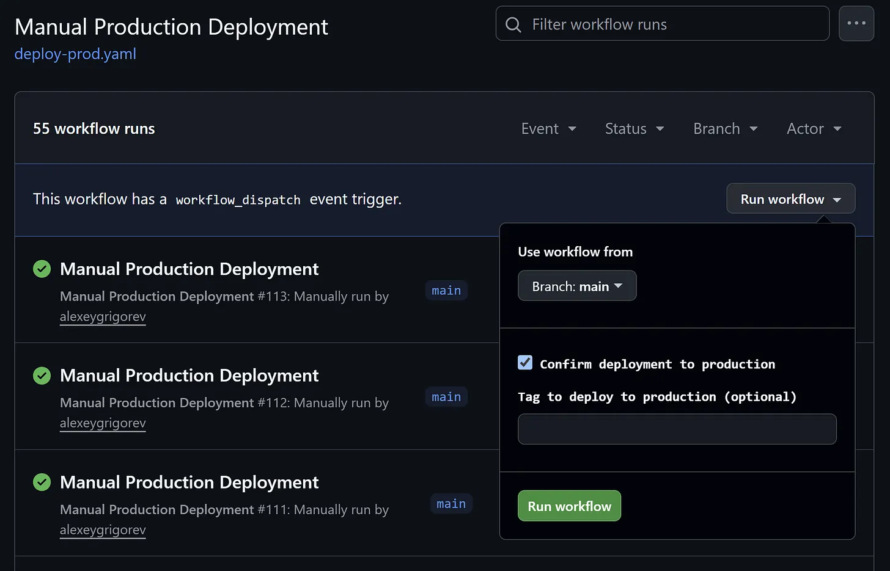
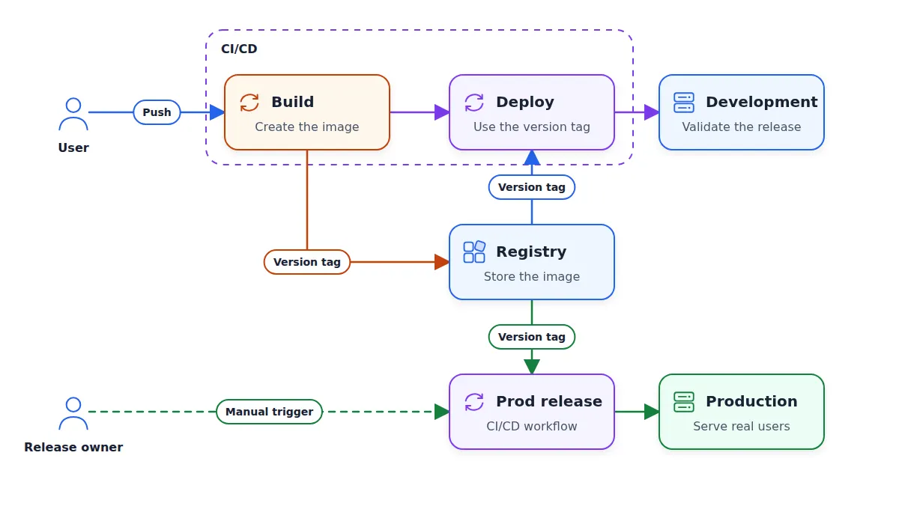
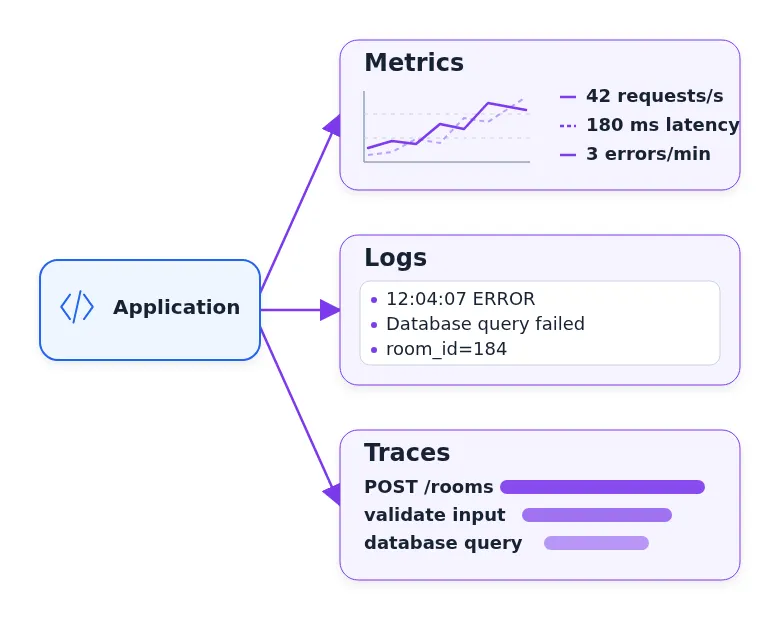
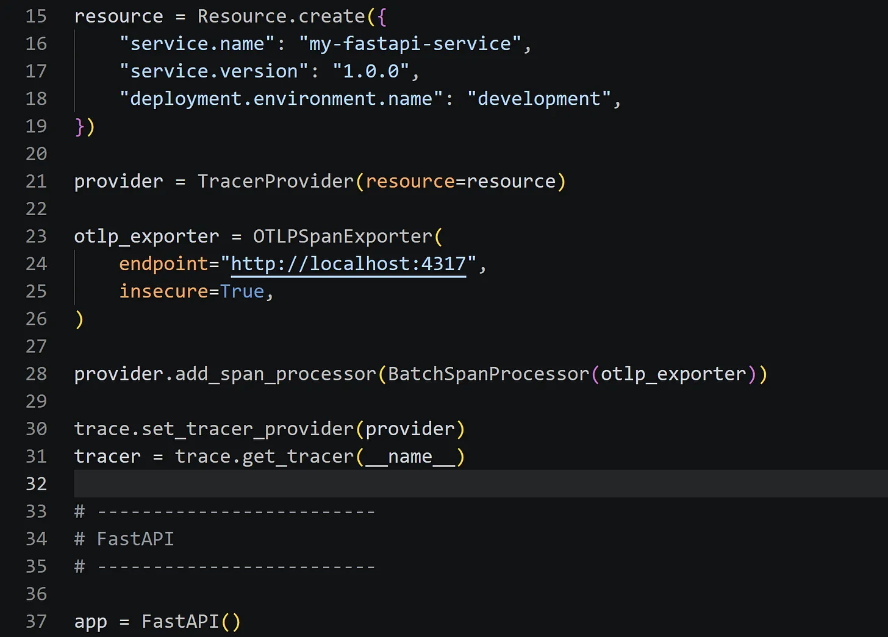

# DevOps and Observability for an AI-Built App

In this article, we’ll make this deployment production-ready:

Separate development and production environments

Create a manual CI/CD trigger for promoting the app from development to production

Use OpenTelemetry to collect metrics, traces, and logs and create

Define application-specific metrics and create a dashboard that displays them

Create an alert when the metrics change

Use an AI agent as the on-call responder for the alerts

<p align="center">
  
  <p align="center">Deploy changes to development first, promote a tested release to production, and respond to observed failures</p>
</p>

## Dev and prod environments

When we push the code, we automatically deploy the changes, and they go live immediately. It’s okay when we are just starting to work on our project. But when we have real users, we want to be more careful and check that our changes didn’t introduce any regressions.

To avoid having this problem, we usually have two copies of the same environment:

- Dev (development): the environment we use internally for checking that everything works. Typically we run the latest version of our project there, and every time we push, the changes are automatically deployed there.

- Prod (production): this is what our users use. We don’t want to deploy every single change there automatically and we want to have more control over the process.

<p align="center">
  
  <p align="center">On push to main we automatically deploy to dev. Promoting from dev to prod happens only after a manual action.</p>
</p>

Because we previously defined our infrastructure as code, we can reuse most of it. We will most likely need to change a few things, like the size of the machine where the application is running, but the majority of the resources will stay the same.

Let’s ask our coding assistant to create a copy of the existing environment and call it “production”:

```
Create a second, independent copy of our infrastructure. We will use the copy as production, and the existing infrastructure as a dev environment.
```

Once we have the prod environment, let’s update our CI/CD. We will only deploy to dev on every push. For production, we will have a manual action that will take whatever development has and promote (apply) it to production.

```
Create a manual GitHub Actions workflow that promotes the dev version to production.
```

<p align="center">
  
  <p align="center">Promotion to prod happens only after a manual approval.</p>
</p>

Now we have two environments.

## Container repository

In the pipeline we have so far, the Docker image is built during the deploy stage. I deploy to EC2 by executing the build script on the machine and then running the image in Docker.

It’s an anti-pattern.

There are multiple problems with this approach:

1. The deploy stage is actually two things: build and deploy. If build fails, there should be no deploy, so it’s better to have these steps separately.

2. When we promote the dev version to production, we have to build again. During this time, many things could have changed, so the build will not be identical to dev, and it can cause problems.

So we split the deploy step into two separate steps:

- Build the image and upload it to a container registry

- Pull this image from the registry during the deploy

When promoting to prod, we simply pull the same image to prod.

For AWS, we can use Amazon ECR as the registry. You can also push your images to Docker Hub or another container registry if you’re running outside of AWS and your cloud doesn’t have a special service for that.

<p align="center">
  
  <p align="center">We split build and deploy into two separate stages inside CI/CD. The build step builds a docker image, tags it and uploads to the registry. The deploy step takes the tag and pushes it to dev. The production release step takes the tag currently deployed in dev and promotes it to prod.</p>
</p>

Let’s implement that:

```
Currently we build the image during the deploy stage.

Split it into two stages:

- Build: build the image and push it to a container registry (ECR)
- Deploy: pull the image from the registry and serve it

The manual prod promotion CI/CD workflow pulls the currently deployed dev image to prod.

Tag each image using the YYYYMMDD-HHMMSS-shortsha pattern (e.g. "20260818-163457-83242da")
```

Now the build step produces a tagged image, and the deploy step deploys it to dev. We can test the dev application, and when we later promote it to production, we will be certain that it’s exactly the same image.

## Observability

Having two environments helps us avoid accidentally pushing buggy code to production. But accidents will still happen, and we need to make sure we detect them and react as fast as possible.

For that, we need to have observability. “Observability” means collecting information about the application so we can understand its behavior. With it, when something breaks, we can quickly find the problem.

We achieve observability by adding monitoring to our applications. At the minimum, we need to collect basic performance metrics like CPU and memory utilization and requests per second (RPS).

If we see that CPU and memory utilization are growing and RPS is dropping, something may be off.

This information alone is not enough. It doesn’t explain what happened inside a request and why it’s causing errors or degraded performance. For that, we need to collect more.

## OpenTelemetry

OpenTelemetry (often abbreviated as “OTel”) is the industry standard for telemetry.

Telemetry is all the information that the application produces:

- Metrics - requests per second, response latency, and number of errors

- Logs - timestamped records of individual events, like an error message or a failed database query

- Traces - all the steps (called “spans”) that a single request makes through the entire application

<p align="center">
  
  <p align="center">Metrics give us concrete numbers, logs give details, and traces show the path of a request with each step.</p>
</p>

OTLP is the protocol that applications use to send this telemetry.

For many popular libraries, we can start capturing telemetry with just a few lines of code. This process is called “instrumenting” - adding telemetry collection to an application. Auto-instrumentation can instrument libraries like FastAPI without changing their code.

<p align="center">
  
  <p align="center">Instrumenting FastAPI is just a few lines of code</p>
</p>

Let’s do it. Ask the coding agent:

```
Instrument the backend with OpenTelemetry.

Include in the telemetry:

- service name
- environment
- deployed version
```

The application now produces telemetry and exports it over OTLP. We still need to decide where to send and store it, and how to view it. Let’s do that now.

## OTel Collectors

We export telemetry over OTLP, but it’s not saved anywhere. For that, we define an OpenTelemetry Collector between the application and the storage systems.

There are many services you can use for that. Ask your AI assistant and select the option that works best for your application.

In our case, I’ll use:

Prometheus for metrics

Loki for logs

Tempo for traces

Grafana for dashboards

I had never used Loki or Tempo before, but when I told my coding agent that I wanted to use Prometheus and Grafana, it suggested including Loki and Tempo too.

So let’s implement it:

```
Add an OpenTelemetry Collector.

Create "observability/" directory with Docker Compose for:

- OpenTelemetry Collector
- Prometheus
- Loki
- Tempo
- Grafana

Keep this as a separate Compose project from the application stack
```

Now we have the infrastructure for observability, so we’re ready to build a dashboard.

## Metrics

Metrics are numerical measurements collected over time. They can show a current value, such as the number of active participants, or count events during an interval, such as rooms created or errors in the last five minutes.

For System Design Canvas, useful measurements may include:

Total number of interview rooms

- Number of active rooms and number of active participants

- Number of elements on the canvas across the application

- Change propagation delay: when I add an element to the canvas, how long does it take for you to see it

- Number of errors

Let’s start collecting some of them:

```
Track these application metrics:

- interview rooms created
- active interview participants
- canvas elements created
- failures in component creation

Include the environment and deployed version
```

Now we have the data and can display it in a dashboard:

```
Add a Grafana panel with these metrics. Make it possible to filter by environment and deployed version.
```

Run it locally and test it by opening our application, creating a room, adding a canvas element, and checking that it appears in Grafana.

<p align="center">
  
  <p align="center">Grafana dashboard with the metrics</p>
</p>

## Deploy the observability stack

If you use the same stack as me (Prometheus, Grafana and others), we need to deploy and manage them ourselves.

If you use a managed OTel-compatible service such as CloudWatch, Grafana Cloud, Datadog, or Sentry, you can skip this step.

So if you’re following my steps, let’s deploy our stack:

```
Deploy the observability stack. It should be separate from the application stack.
Connect both development and production to it.
```

After it finishes, you can open Grafana and perform the same test that we did locally.

<p align="center">
  
  <p align="center">Development and production export telemetry through OTel. The collector sends metrics to Prometheus, logs to Loki and traces to Tempo. Grafana reads from them and displays this information on dashboards.</p>
</p>

Note: here we deploy Grafana and the other services openly on the Internet, so everyone can access them. In practice, you put sensitive resources like observability services and databases on private networks, restrict network access, and require authentication so only authorized users can access them.

## Alerting

We have the dashboards, but we can’t watch them all the time to see if some metrics drop or grow too large. If this happens, we need a system that triggers an alert saying that something happened.

```
Add an actionable alert for repeated canvas component-creation failures.

Use a threshold and duration that represent real user impact. Include the
service, environment, deployed version, owner, and dashboard URL in the alert.
```

## On-Call Engineer

Now that we have alerts, we need to react to them. In companies, there’s usually an on-call engineer. That’s the engineer who receives the alert when something happens. They need to figure out what’s happening and find a quick solution to stop the problem.

When a metric crosses its threshold for long enough, the alert fires and the on-call engineer receives it.

Our AI assistant can be the on-call engineer, and if something happens, it can try to fix it. In real scenarios, AI on-call agents also need to understand if the issue is serious enough to escalate the alert to a human on-call engineer.

In our case, we won’t do it. We will implement a system that checks the observability system for alerts, and if something is happening, an agent session will start and try to fix the problem.

```
Add an on-call-engineer/ directory with a script that polls the observability
alert API every minute.

When an alert fires, pass the alert details to a headless coding agent.
```

As a result, we have a worker that polls for alerts and starts an agent session when one fires.

In my case, the agent had this prompt:

```
You are the on-call engineer for this repository. An alert just fired.

Investigate the root cause. Read the code and reproduce the failure.
If you find a real bug, make the smallest correction, run the backend tests,
and commit the fix with a clear message.

If the alert is a false positive, explain why and do not change the code.
```

This is a small proof-of-concept script. In reality, you will probably have a system that looks like this:

- An alert is triggered and sent via SNS or a similar service.

- A Lambda reacts to that alert and starts a container job.

- The job launches Codex or Claude in headless mode.

- Once the session is over, the logs are saved and the compute is terminated.

<p align="center">
  
  <p align="center">The alert starts an agent running inside a container job. When the job is done, the agent saves the log and the machine is teminated.
</p>
</p>

Let’s test our idea by introducing a bug.

## Introducing a bug

We want to test that this system works, so let’s start a coding agent and ask it to add a bug or find an existing one.

```
Introduce a realistic bug in canvas component creation.

For some requests, creating a component should fail even though the existing tests pass. Keep the failure reproducible so we can test that the bug causes an alert and the on-call response.
```

Here, the goal is to debug the process and make sure our on-call engineer actually wakes up and solves the problem.

After a few iterations, we have an on-call engineer that wakes up when there’s an alert and tries to fix the problem.

## Clean up

After you finish everything for the module, I recommend cleaning up everything. We created these things for learning, so we shouldn’t forget to clean them up. If you don’t, expect a bigger bill at the end of the month.

steps after this module
We started with an idea, and now our setup is much closer to production. But here I could only briefly touch on the most important concepts.

There are many more things that you should consider for a real production application:

- Here I deploy to EC2 by running a shell script on the instance. It’s okay for a proof of concept but very problematic for production. Use a container management system like ECS or an alternative.

- Sometimes you will need to roll back a change you promoted to prod. Ask your agent to make it easy to do.

- Use a managed database service.

- Regularly back up your database. It’s best if your backups live outside of your infrastructure-as-code stack and you have multiple independent copies.

- Test that you can actually use these backups.

- Put internal services and resources on private subnets inside a VPC, and restrict network access to them.

- If your application needs to handle a lot of traffic, learn about scaling and load balancing. Container management systems make this easier to manage.

- Ask Fable or GPT-5.6-Sol Max (better both) to audit your code for security vulnerabilities. Do it multiple times.
